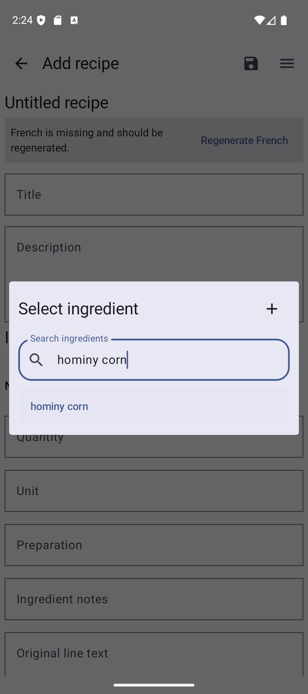
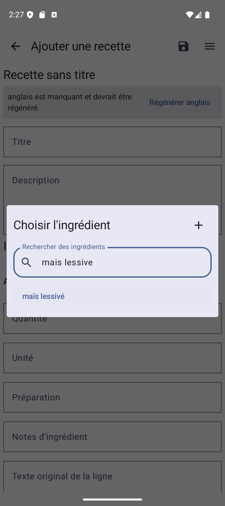

# Hominy Corn Identity Integration — WP03 Section F

**Date:** 2026-10-07  
**Status:** Integrated as an identity-only row; independent Québec French review and wider Section F review remain open.

## Accepted identity

| Field | Value |
| --- | --- |
| ID | `ingredient-ref-hominy-corn` |
| English | `hominy corn` |
| fr-CA | `maïs lessivé` |
| Category | `VEGETABLE_AND_AROMATIC` |
| Aliases | None |
| Density / mappings / forms / yields / conversions / substitutions | None |

[OQLF's *maïs lessivé* entry](https://vitrinelinguistique.oqlf.gouv.qc.ca/fiche-gdt/fiche/17059882/mais-lessive) directly pairs *hominy corn* with *maïs lessivé* and defines a processed product made from mature dry yellow or white corn held in preservative liquid. [CFIA's product table](https://inspection.canada.ca/fr/exportation-aliments-plantes-ou-animaux/exportations-daliments/certification/certificat-vente-libre/tableau-produits) lists *Maïs lessivé* under *Maïs hominy*. [TERMIUM's hominy record](https://www.btb.termiumplus.gc.ca/tpv2alpha/alpha-eng.html?fchrcrdnm=23&i=&index=enb&lang=eng&sg_kp_wet=1113184&srchtxt=CAUSTIC) distinguishes lye-treated from pearled hominy and describes corn grits as ground hominy. These sources support the named processed-corn identity while preserving distinctions from unqualified hominy, lye hominy, pearled hominy, hominy grits, corn grits, cornmeal, masa harina, and pozole corn [WP03-S125–S127].

No alias or ingredient-form relation was added. The internal category matches the existing corn-kernel reference. The ledger records the accepted identity boundary and the separate measurement and substitution research states.

## Coverage and collisions

- Scanned all 114 bundled recipe files. None contains hominy, *maïs lessivé*, grits, or pozole wording; no recipe link or quantity changed.
- In the 360-reference catalog, normalized display/alias keys `hominy corn` and `mais lessive` each occur once and resolve to this ID.
- The record has empty bilingual alias lists, null density, and no unit mappings. The existing corn-kernel, cornmeal, and masa-harina records remain separate.
- The seed stores the French display with explicit Unicode escapes (`ma\u00efs lessiv\u00e9`). Maintained prose is UTF-8 without BOM.

## Package and generated-index evidence

At verification, the seed contained 360 ingredient references. SHA-256:

| File | SHA-256 |
| --- | --- |
| `app/src/main/assets/seed/bundled-library/ingredient-references.v1.json` | `b75c568f05ea65d504bb2c1c90b09e0fd2213098e65ffaaad5dae03c9c5527ac` |
| `app/src/main/assets/seed/bundled-library/manifest.v1.json` | `b49f39ff983ebab9caf853afc505ea1f0bb08cf11d0386edac1380baaeccb984` |
| `app/src/main/java/app/recipebook/data/local/recipes/BundledIngredientCatalog.kt` | `bba014303e40252963f5b557de9de2afb6dfe4505e29bd58969654e6c9f68b8e` |
| `docs/catalog/research-ledger.v1.json` | `c29a32bf8eb9db4b5404f9653f535d9d63b714cd92b4e453e6265f4eb446504b` |

The seed normalizer, full bundled-package normalizer, and generated Kotlin index each passed `--check`. The research ledger passed its JSON schema validation. The full package normalizer reported zero changed parts.

## Tests and Pixel 9a verification

- Android unit tests: 257 passed, 0 failures, 0 skipped.
- Seed-package Python tests: 9 passed.
- Connected Android instrumentation on the Pixel 9a AVD, Android 16 / API 36: 29 test cases, 27 passed, 2 skipped, 0 failures. The skipped cases are OpenRouter settings persistence and editor activity recreation.
- The prescribed deploy script completed its Gradle test/build steps, installed the debug APK, and launched `MainActivity`.
- Picker navigation found one `hominy corn` result in English. After changing the temporary profile to French in the app menu, searching the accent-normalized phrase `mais lessive` returned one displayed result, `maïs lessivé`.
- The original AVD user-data image was preserved. Verification used the same Pixel 9a/API 36 configuration with a separate temporary `/tmp` user-data image because the original profile did not have enough free storage to install the APK. The original AVD is running again with its package-private data retained; `app.recipebook` remains uninstalled there (`installed=false`) and `/data` has 393 MB free.

### Picker screenshots

| Screenshot | SHA-256 |
| --- | --- |
| `hominy-corn-picker-en.png` | `c88b5496f55bc914c8a7cad0359ba9f8c35f394540948764812943f9ee30ed33` |
| `hominy-corn-picker-fr.png` | `27fbe8776bb9bbe8d4fa77af58585c8efb7b5ccb0a3f8e5026b50b589b17555e` |

The integrated row is complete. Broader Section F work and independent Québec French review remain open in the plan and `roadmap.md`.
